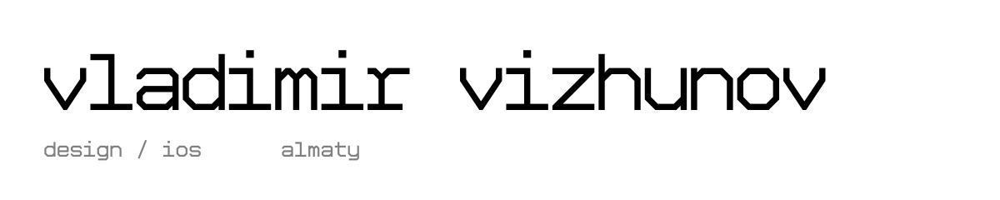

<picture>
  <source media="(prefers-color-scheme: dark)" srcset="assets/banner-dark.svg">
  
</picture>

designer and developer in almaty.
i work on identity, interfaces and internal tools. mostly in figma, sometimes in code.

### work

- [web design system](https://rockstaneverdie.github.io/portfolio/work/design-system.html) for an exhibition-stand builder
- [design hub](https://rockstaneverdie.github.io/portfolio/work/design-hub.html), an internal portal for brand files
- [proposal platform](https://rockstaneverdie.github.io/portfolio/work/proposal-platform.html), sales proposals as web pages
- [koko](https://rockstaneverdie.github.io/portfolio/work/koko.html), my ios app for learning sign language

all case studies: [rockstaneverdie.github.io/portfolio](https://rockstaneverdie.github.io/portfolio/)

### code

- [koko-sign-app](https://github.com/rockstaneverdie/koko-sign-app): ios app for learning russian sign language. swift, vision, create ml
- [whatchasay](https://github.com/rockstaneverdie/whatchasay): firefox extension, subtitles and slang explained in context. svelte, typescript
- [portfolio](https://github.com/rockstaneverdie/portfolio): the site above. html, css, python

### contact

[telegram](https://t.me/stillrocksta) · [instagram](https://instagram.com/stillrocksta) · [linkedin](https://www.linkedin.com/in/vladimir-vizhunov-5964213b5/) · [email](mailto:rockstaneverdie@gmail.com)
